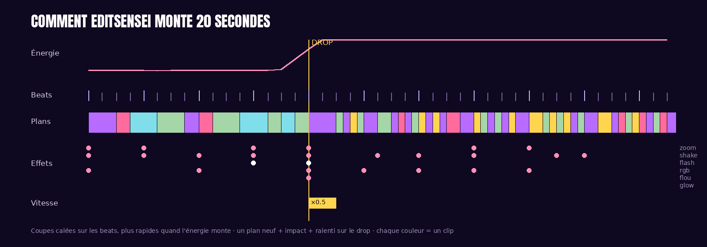
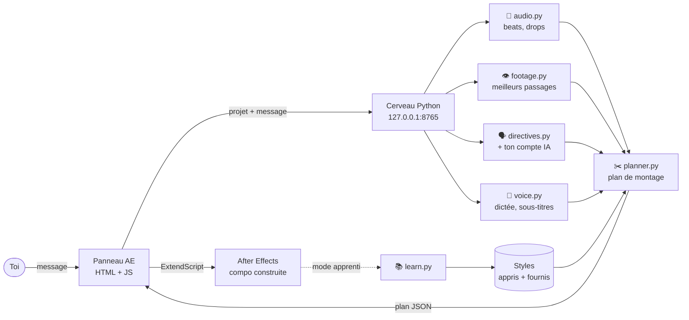

<p align="center">
  
</p>

<p align="center">
  
  
  
  
  
</p>

**EditSensei** est un assistant de montage qui vit **dans After Effects**. Il est piloté par **ton compte IA** (Claude, Gemini, ChatGPT, DeepSeek ou Copilot). Tu importes tes clips et ta musique, tu lui parles (au clavier ou **à la voix 🎤**) comme à un monteur (« fais un edit anime de 30 s en vertical, slow-mo au drop »), et il **construit la composition de A à Z** : coupes calées sur les beats, impacts sur les drops, zooms, shakes, flashs, ralentis, titres, look…

Et surtout : **il apprend**. Montre-lui un edit que tu aimes, ou laisse-le te regarder monter : il en tire un style qu'il réutilise.

<p align="center"></p>

---

## 💬 Exemple de conversation

*(réponses réelles du cerveau sur une musique de test à 128 BPM)*

> **Toi :** Fais un edit anime de 20 s en vertical, slow-mo au drop
>
> **EditSensei :** J'ai monté 20 s en style « Anime » sur un tempo de 129 BPM · 53 plans coupés sur les beats · 1 drop avec impact et ralenti · 10 shakes, 7 RGB split, 6 zooms, 2 flashs. Consignes appliquées : style « Anime », 20 s, format vertical 9:16, ralenti au drop.
> ✅ Compo « EditSensei 01 · Anime » créée. Ctrl+Z pour tout annuler.
>
> **Toi :** plus agressif, sans flash
>
> **EditSensei :** *(remonte une nouvelle version en gardant le vertical et le texte)*
>
> **Toi :** 👍
>
> **EditSensei :** Merci ! J'ai gardé ce montage comme exemple : « Mon style » a maintenant 1 exemple.

---

## ✨ Ce qu'il sait faire

| | |
|---|---|
| 🎵 **Écouter** | Tempo, beats, premiers temps, énergie, changements de partie et **drops** (précision ±0,03 s sur nos tests) |
| 👁️ **Regarder** | Mouvement, netteté et coupes internes de chaque clip, pour choisir les **meilleurs passages** (action sur les passages forts, plans posés sur les calmes, jamais deux fois le même moment) |
| ✂️ **Monter** | Coupes sur le beat (plus rapides quand ça monte), plan neuf + impact + ralenti sur chaque drop, effets dosés selon le style |
| 🎬 **Construire dans AE** | Une vraie compo éditable : calques nommés, caméra nulle (zooms + secousses par expression), calques de réglage (flou de transition, RGB split, glow, look), flash, vignette, bandes cinéma, titres animés, fondus — **un seul Ctrl+Z annule tout** |
| 🗣️ **Comprendre** | Les consignes en français, sans clé API : style, durée, format (9:16, 1:1…), énergie, « plus de / moins de / sans » chaque effet, ralenti, texte, noir et blanc… Les consignes **se cumulent** au fil de la conversation |
| 📚 **Apprendre d'une vidéo** | « Apprends le style de ref.mp4 » → il détecte coupes, flashs, zooms, secousses, flous et RGB split image par image, les replace sur la grille musicale et crée un nouveau style |
| 👀 **Mode apprenti** | Il observe ta compo pendant que tu montes et enrichit « Mon style » avec tes habitudes |
| 🤖 **Ton compte IA** | Claude, Gemini, ChatGPT, DeepSeek ou Copilot pilote la conversation : demandes libres (« rends ça plus émouvant vers la fin »), questions, réglages fins. Branche-le avec **ton compte** (aucune clé à copier) ou une **clé API**, depuis ⚙️ dans le panneau. Sans IA, les consignes simples marchent quand même en local |
| 🎤 **Dictée** | Clique sur le micro, parle : ton message s'écrit et part tout seul quand tu te tais. Transcription **hors ligne et gratuite** (Whisper local), ou par ta clé ChatGPT / Gemini |
| 💬 **Sous-titres auto** | « Ajoute les paroles » : la voix de la musique (ou du premier clip) est transcrite avec ses horodatages et posée en sous-titres dans la compo |

### Styles inclus
`Anime` · `Aggressive` · `Smooth` · `Gaming` · `Cinématique` — plus tous ceux qu'il apprend (`✦` dans la liste).

---

## 🚀 Installation

**Prérequis :** After Effects 2022 ou plus récent (Windows ou macOS). Python, FFmpeg et le reste s'installent tout seuls.

**Windows** — clic droit sur `scripts/install_windows.ps1` › *Exécuter avec PowerShell*
**macOS** — `bash scripts/install_macos.sh`

Puis redémarre After Effects : **Fenêtre › Extensions › EditSensei AI**.
Le panneau démarre son cerveau tout seul (sinon : `scripts/start_brain`).

### Brancher ton IA (⚙️ dans le panneau)

| IA | Avec ton compte (aucune clé) | Avec une clé API |
|---|---|---|
| **Claude** | abonnement Pro/Max via Claude Code : `npm i -g @anthropic-ai/claude-code` | [console.anthropic.com](https://console.anthropic.com/settings/keys) |
| **Gemini** | compte Google via Gemini CLI : `npm i -g @google/gemini-cli` | gratuite sur [aistudio.google.com](https://aistudio.google.com/apikey) |
| **ChatGPT** | compte ChatGPT Plus/Pro via Codex : `npm i -g @openai/codex` | [platform.openai.com](https://platform.openai.com/api-keys) |
| **DeepSeek** | — | [platform.deepseek.com](https://platform.deepseek.com/api_keys) |
| **Copilot** | compte GitHub Copilot via Copilot CLI : `npm i -g @github/copilot` | jeton GitHub avec la permission *Models* (gratuit) |

1. Choisis l'IA, puis **Mon compte** ou **Clé API**.
2. *Mon compte* : clique **🔑 Se connecter** (un terminal s'ouvre, tu te connectes une seule fois). *Clé API* : colle ta clé puis **💾 Enregistrer**.
3. **🧪 Tester** : l'IA te répond ; le statut du panneau affiche « Prêt · Claude (compte) ».

Le mode compte demande [Node.js](https://nodejs.org). Les réglages sont enregistrés dans `~/.editsensei/accounts.json`, lisible par toi seul. L'IA n'a accès à aucun de tes fichiers : elle reçoit seulement ta demande et un résumé du projet, et renvoie des consignes que le moteur local applique.

**Micro sur macOS :** Réglages Système › Confidentialité et sécurité › Micro › autorise After Effects.

---

## 🎛️ Utilisation

1. Importe tes **clips** et ta **musique** dans le projet (sélectionne-les pour qu'il n'utilise qu'eux).
2. Dans le panneau, écris ta demande ou clique **🎬 Monter**.
3. Ajuste en discutant (ou en parlant avec 🎤) : « plus calme », « une autre version », « commence par le clip 3 », « bandes noires », « ajoute les paroles »…
4. **👍** quand une version te plaît : elle devient un exemple de ton style.
5. **📚 Apprendre** : sélectionne un edit de référence dans le panneau Projet et clique.
6. **👀 Apprenti** : active-le et monte normalement, il apprend en te regardant.

### Sans After Effects (aperçu MP4)
```bash
brain/.venv/bin/python scripts/edit.py musique.mp3 clip1.mp4 clip2.mp4 -m "edit anime 30s slow-mo au drop" -o edit.mp4
brain/.venv/bin/python scripts/edit.py --learn reference.mp4 --name "Mon AMV"
```

---

## 🧠 Comment ça marche



Le détail est dans [`docs/ARCHITECTURE.md`](docs/ARCHITECTURE.md).

**Comment il apprend, honnêtement :** ce n'est pas un réseau de neurones géant entraîné sur des millions de vidéos. C'est un **apprentissage statistique** : pour chaque exemple, il mesure à quel rythme on coupe selon l'énergie de la musique et quelle proportion de drops, de premiers temps ou de beats reçoit chaque effet. Ces chiffres forment un style (un fichier JSON lisible dans `~/.editsensei/styles`). Les exemples se mélangent : plus tu lui en montres, plus ton style s'affine. Avantage : ça marche dès **un** exemple, tourne sur n'importe quel PC et reste transparent.

---

## 🧪 Tests

```bash
cd brain && .venv/bin/python -m pytest -q
```
31 tests sur des médias générés à la volée :
- précision du tempo et du drop ;
- compréhension des consignes ;
- continuité du montage et coupes sur les beats ;
- ralenti et impact au drop ;
- aperçu vidéo ;
- apprentissage en boucle fermée : il monte une vidéo puis réapprend son style en la regardant, et retrouve plus de 90 % des coupes ;
- mode apprenti ;
- conversation ;
- les 5 IA (clé API simulée) et le mode compte (outil en ligne de commande simulé), retour au mode local si l'IA tombe ;
- dictée (endpoint `/transcribe`) et sous-titres jusque dans l'aperçu et After Effects ;
- construction de la compo dans un **After Effects simulé** (`ae-panel/tests/mock_ae.js`).

---

## 🗺️ Prochaines étapes

- [ ] Tester et régler sur de vrais projets After Effects (Windows/macOS)
- [ ] Reconnaissance des visages / du sujet pour recadrer le format vertical
- [ ] Transitions supplémentaires (zoom-through, glitch, light leaks)
- [x] Sous-titres automatiques depuis les paroles
- [ ] Tester le mode compte de Gemini, ChatGPT et Copilot (seul Claude a été essayé en vrai)
- [ ] Modèle neuronal entraîné sur la bibliothèque de styles appris

## 📄 Licence
MIT — © 2024-2026 Dev Gninoue & PUOS
